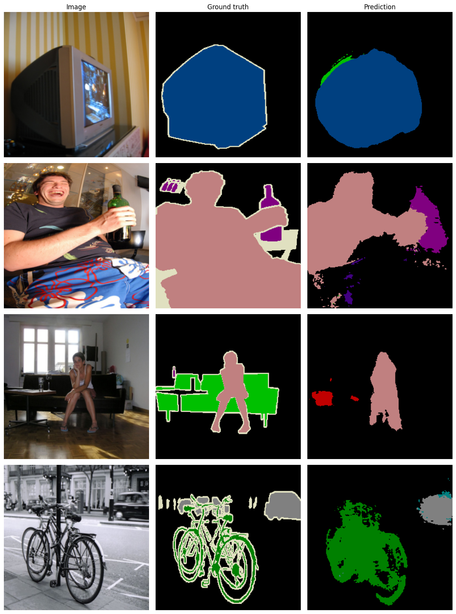
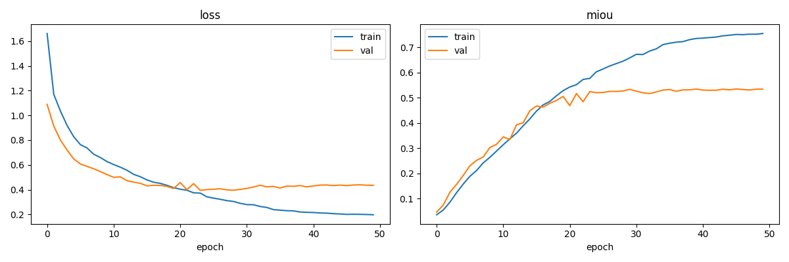

# Semantic Segmentation on PASCAL VOC 2012

This started as my final project for the Advanced AI course during my master's at Northeastern University (China).

## Results

Evaluated on the official VOC 2012 `val` split (1,449 images) at 256×256.

| Metric         | Value |
| -------------- | ----- |
| mIoU           | 56.5% |
| Pixel accuracy | 89.2% |

Per-class IoU

| Class      | IoU   | Class       | IoU   |
| ---------- | ----- | ----------- | ----- |
| background | 0.895 | sheep       | 0.606 |
| bus        | 0.734 | tvmonitor   | 0.588 |
| car        | 0.706 | boat        | 0.580 |
| aeroplane  | 0.706 | bottle      | 0.563 |
| person     | 0.688 | cow         | 0.500 |
| cat        | 0.688 | horse       | 0.471 |
| bird       | 0.645 | diningtable | 0.420 |
| motorbike  | 0.637 | bicycle     | 0.394 |
| dog        | 0.630 | pottedplant | 0.327 |
| train      | 0.627 | sofa        | 0.278 |
|            |       | chair       | 0.182 |

The model does best on large, rigid objects (bus, car, aeroplane) and worst on chair, sofa, potted plant
and bicycle, which are thin, often occluded, and easily confused with each other in indoor scenes.

## Training Curve

